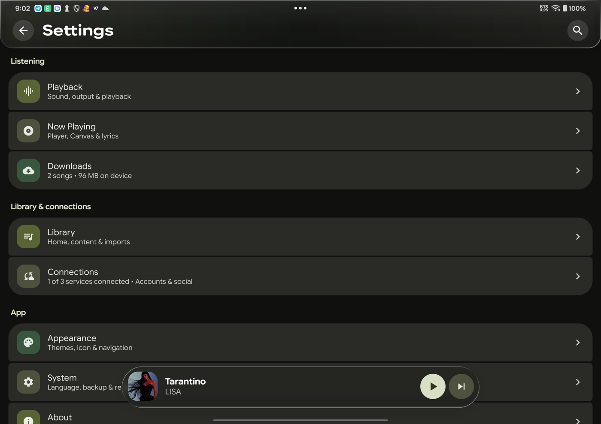
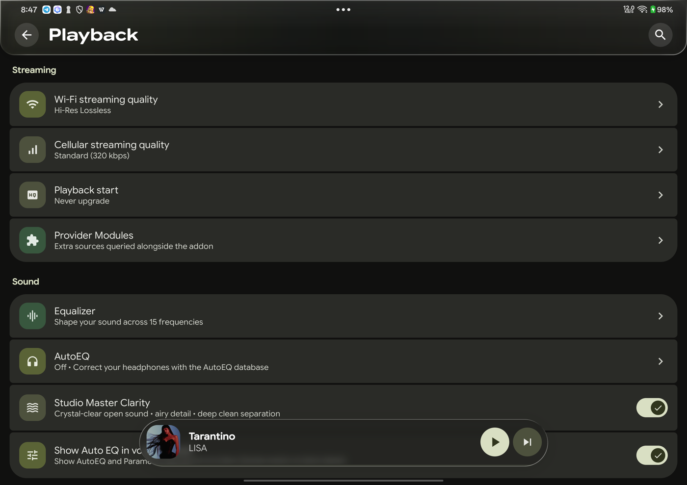
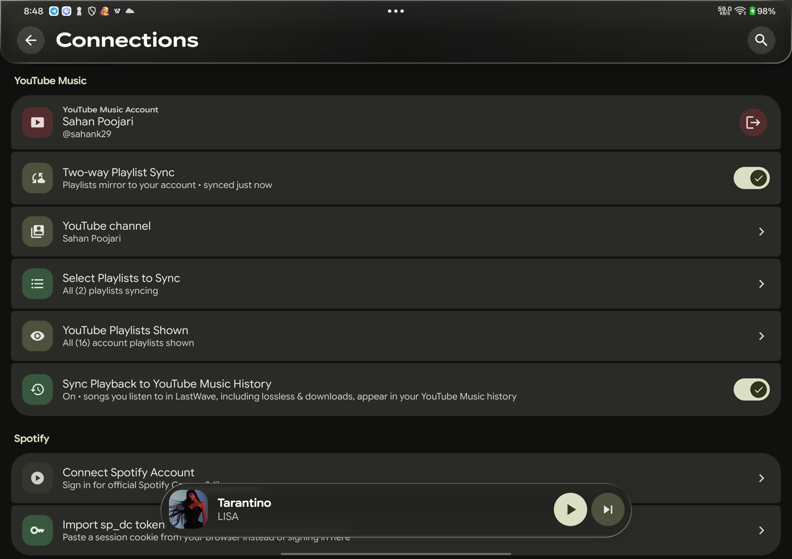
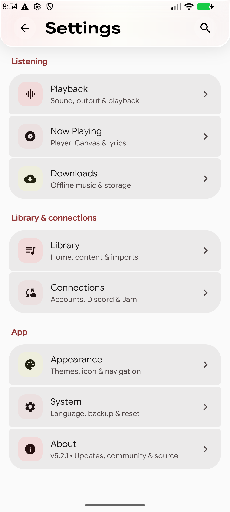
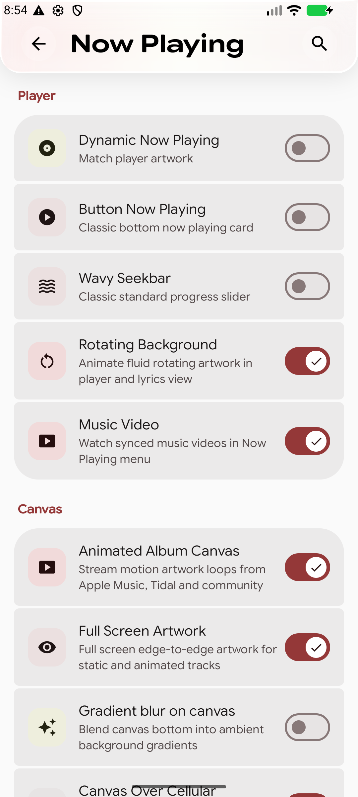
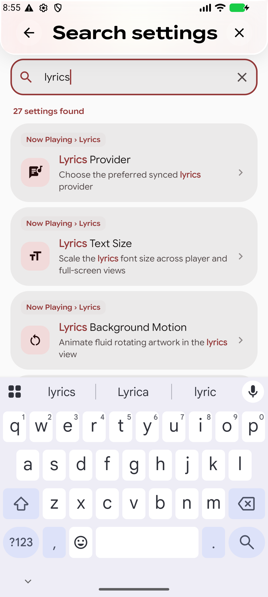
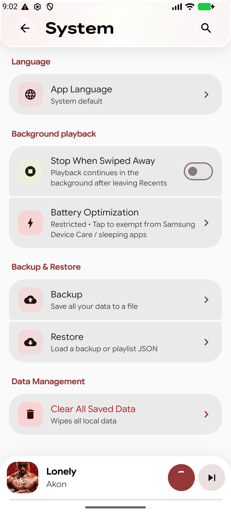
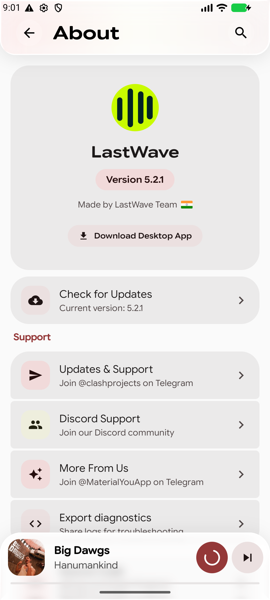

# Settings redesign

Reorganises LastWave's settings around what the user is trying to change instead of
which part of the code owns the setting.

Full setting-by-setting location map: [SETTINGS_STRUCTURE.txt](SETTINGS_STRUCTURE.txt).

## One Settings screen, two view states

There is still only one Settings destination. The header **Settings** is the index;
tapping a category swaps the body and the header title inside the same screen
(Playback, Now Playing, Appearance, Library, Downloads, Connections, System, About).
No second Settings screen or navigation entry is pushed.

The index is needed because the app now exposes 89 settings. A single flat list would be
several screens of scrolling, and the old 8-tab strip did not scale.

## New categories

| Root group | Category | Sections |
|---|---|---|
| Listening | **Playback** | Streaming · Sound · Output · Playback |
| Listening | **Now Playing** | Player · Canvas · Lyrics |
| Listening | **Downloads** | Files · Quality |
| Library & connections | **Library** | Home · Content · Imports |
| Library & connections | **Connections** | YouTube Music · Spotify · Last.fm · Social |
| App | **Appearance** | Theme · Accent · Icon & text · Layout |
| App | **System** | Language · Background playback · Backup & restore · Data |
| App | **About** | Support |

## What moved

- Download quality and download lyrics moved from Audio to **Downloads → Quality**.
- Download management and Storage now live in **Downloads → Files**; this screen was
  previously unreachable from Settings.
- Stop-on-recents and battery optimisation moved from Audio to **System → Background playback**.
- All lyrics controls (provider, offset, size, word-by-word, auto-hide, translation,
  background motion, keep-awake) are together in **Now Playing → Lyrics**.
- Canvas (including Spotify Canvas) is together in **Now Playing → Canvas**.
- Recipe: player chrome (dynamic background, button mode, wavy seekbar, rotating
  background, music video) is in **Now Playing → Player**.
- YouTube Music, Spotify, Last.fm, Discord and Jam are together in **Connections**.
- Recommendation provider and exclusions are in **Library → Content**.
- Provider Modules moved from the root card to **Playback → Streaming**.
- App language moved from About to **System → Language**.
- About now leads with version/update info, then support links.

Duplicates removed: YouTube/Spotify import rows duplicated in their account tabs,
"Make YouTube Playlists Local", the standalone desktop-app row, and the never-rendered
`YouTubeImportSheet.kt`.

## Search

The search catalog is rewritten against the new tree:

- 89 entries; every searchable setting has one.
- One section-order list per tab drives both rendering and jump-to-section scrolling.
- A unit test asserts every catalog section exists in that order.
- Added previously unsearchable settings (Music Haptics, Hide Navigation Tabs,
  Collapsing Navigation Bar, Button Now Playing, Word-by-Word Lyrics, Show AutoEQ in
  Volume Panel, Spotify Playlists in Library, Cookie Login, Jam, Downloads/Storage).
- Removed the phantom "Lyrics Animation Style" entry and duplicate import entries.

## Screenshots

### Tablet (OnePlus Pad, dark)

| Settings index | Playback | Connections |
|---|---|---|
|  |  |  |

### Phone (1080×2400, light)

| Settings index | Now Playing | Search |
|---|---|---|
|  |  |  |

| System | About |
|---|---|
|  |  |

## Verification

- `./gradlew :app:assembleDebug` passes.
- `./gradlew :app:testDebugUnitTest --tests "com.lastwave.app.ui.settings.*"` passes.
- Built and checked on a OnePlus Pad (OPD2403, Android 16) and a 1080×2400 emulator,
  light and dark.
- Search "lyrics" → tap result → opens Now Playing and scrolls to the Lyrics section.

## Known gaps

- Download folder/location/structure remain in the Downloads screen overflow menu.
- `preferLosslessStreaming` and `clarityPreset`/`clarityAtmosBypass` still have no UI.
- Tablet content width is not capped (`fillMaxSize` before `adaptiveContentWidth`);
  a two-pane tablet settings layout is the follow-up.
- Section labels are still English-only; category titles use string resources.
