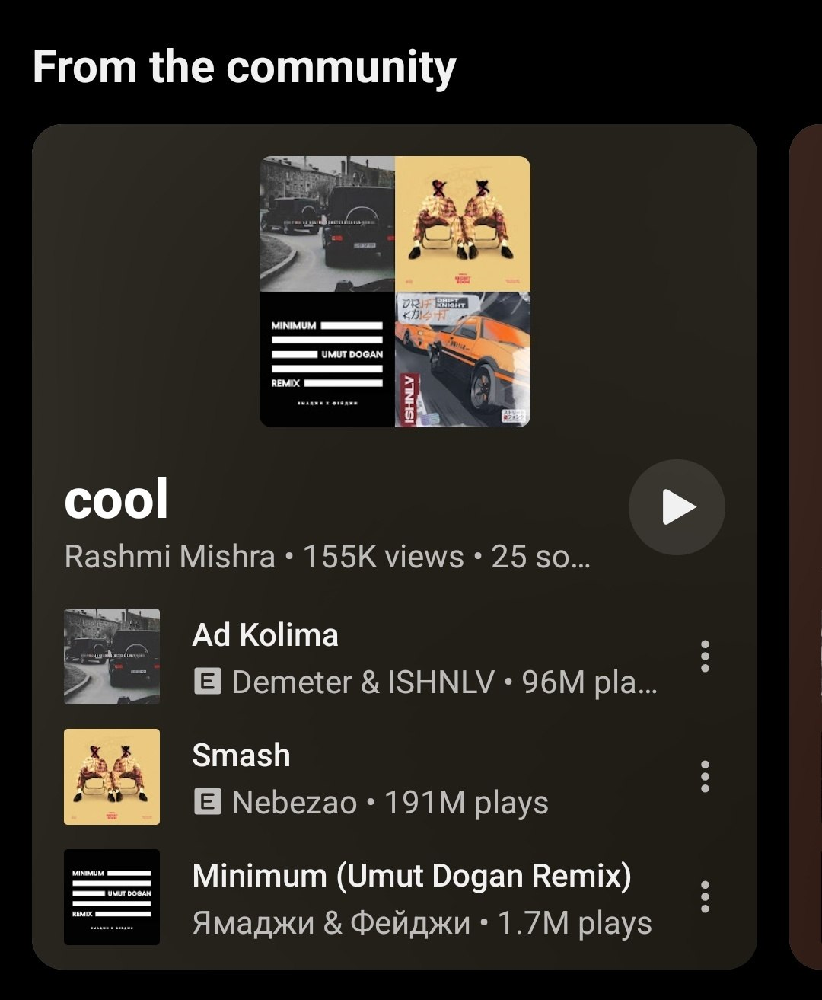
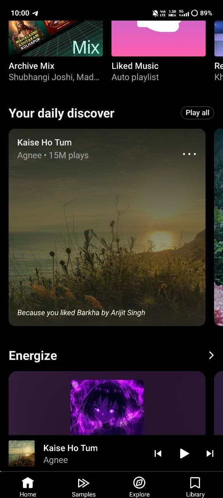

# Community playlists and daily discover cards

Home now selects the two large card styles from YouTube Music's renderer and endpoint data. Community cards fetch one playlist page when visible, cache the result for the Home session, and share a two-request limit. Playlist play, song play, Play all, navigation and track menus use the existing handlers.

The branch starts from upstream `0393393`. Home UI points 1 and 2 are ancestors of that base; `fix/queue-refill-size-and-feed-tap` is not. Six commits are retained without squashing.

## Data verified against the supplied captures

- Community items are square `musicTwoRowItemRenderer` objects with a `VL…` playlist browse endpoint and a **first** subtitle run linking to `MUSIC_PAGE_TYPE_USER_CHANNEL`. Home supplies no preview songs. Shelf titles do not participate in detection.
- The playlist response contains 13 responsive song rows. The header is `musicResponsiveHeaderRenderer`, with `13 tracks` in `secondSubtitle`. The preview reads three songs and scans further rows for four distinct covers. It does not follow continuations or include recommendations.
- Daily items are square two-row songs with watch endpoints. Their item endpoints contain `RDAMVM<videoId>` and `wAEB`; the header's Play all watch endpoint has a video ID and params, but **no playlist ID**. The captured covers have 226px and 544px variants; the large card selects 544px.
- The separators are ` • ` rather than double spaces. The captured playlist's first three entries are uploaded videos with USER_CHANNEL uploader names, 400×225 thumbnails, and no play counts. Their secondary line therefore shows the uploader only.
- None of the nine captured daily items has a caption. The UI does not create one. Captions are displayed only when the existing parser supplies a real caption field.
- The Home capture contains community, New releases and daily shelves. Normal-playlist and responsive Quick picks negatives are explicitly documented mutations of the captured excerpts.

Sanitized excerpts are in `app/src/test/resources/home_cards/`; tracking, logging, menus and session data are omitted.

## Files and scope

| Area | Files |
| --- | --- |
| Additive models/parsing | `HomeShelf.kt`, `HomeCardData.kt`, `PlaylistPreview.kt`, small additions to `InnerTubeMusicApi.kt` |
| Preview requests/cache | `PlaylistPreviewLoader.kt`, `PlaylistPreviewViewModel.kt` |
| Card presentation/selection | `ShelfCommunityPlaylistCard.kt`, `ShelfFeaturedCard.kt`, `HomeCardVariant.kt`, `CommunityDiscoverShelf.kt` |
| Handler/header wiring | `HomeShelfCard` and its three call sites in `FeedScreen.kt`; daily-only outlined option in `ShelfHeaderV2.kt` |
| Verification | `HomeCommunityDiscoverDataTest.kt`, `PlaylistPreviewLoaderTest.kt`, `CommunityDiscoverShelfTest.kt`, the related `HomeCardVariantTest.kt`, fixtures, `CommunityDiscoverPreviews.kt` |

Deliberately untouched: queue, radio, continuations, automix, queue lock/stats, login popup, player, history/telemetry, Last.fm, Home fetching, chip fetching/filtering, pagination, section ordering, navigation, Quick access, Infinite Radio, Artist Spotlight, Speed Dial, Moods and Genres, podcasts, theme, settings, search, lyrics and Explore. Shared Square/Wide composables, CardTokens, artwork primitives and the full track menu are unchanged. Project build files and dependencies are unchanged.

## References and previews

| Community reference | Daily reference |
| --- | --- |
|  |  |

`CommunityDiscoverPreviews.kt` contains 11 Compose previews of the actual card composables, covering normal, loading, failed/missing artwork, long titles, Hindi/Marathi, RTL and tablet/landscape sizes. Preview artwork uses deterministic missing-art fallbacks. Rendered app screenshots and device interaction checks remain pending: ADB cannot create its Android preferences directory in this execution environment.

## Validation

- Full `:app:testDebugUnitTest` execution: **668 tests, 589 passed, 79 failed, 0 skipped**.
- All **26 directly relevant tests passed**: 13 captured-data/parsing tests, 4 loader tests, 7 card-selection tests and 2 sizing/key tests. Nineteen are new.
- All 79 failures are in 13 existing Robolectric suites. Their failure is `Couldn't create lock file C:\.robolectric-download-lock`. No unrelated test was edited.
- Kotlin, generated Java and unit-test sources compiled. The tests ran without excluding prerequisite tasks after local build-path adaptations.
- Separate-ID APK build attempted with all prerequisite tasks enabled. It reached native compilation, then failed because execution of the installed NDK's `clang++.exe` was denied. **No new APK was produced.** Native source and build configuration remain unchanged.

Local tooling adaptations use the installed NDK's Python and byte-identical cached Gradle/dependency/SDK JAR copies under ignored `.gradle_home/`. They do not modify project build settings or dependencies. The full test report is `app/build/reports/tests/testDebugUnitTest/index.html`.

For a separate installable debug application, use `docs/community-daily-discover.init.gradle` with Gradle's `--init-script` option. It applies the temporary `.communitytest` application ID suffix.

## Logged-in manual checklist

- [ ] Community shelf shows centered collages, titles, round play buttons, author/views/count lines and the first three song rows.
- [ ] Each row plays its own video ID; its three-dot button opens the existing track menu.
- [ ] The round button plays the playlist; tapping the collage/title/stats opens it.
- [ ] Daily shelf shows large square cards with a peeking next card and snapping.
- [ ] Covers zoom out once, do not restart after scrolling away/back, and stay still with system animations disabled.
- [ ] Daily tap, three-dot menu and Play all work through the existing handlers.
- [ ] No daily caption is invented, and absent play/count fields are omitted.
- [ ] Offline preview failure leaves a stable card with cover/title/stats/play; scrolling back does not repeat requests.
- [ ] Guest/unknown renderer data uses ordinary cards; other shelves, queue and player behave as before.
- [ ] Check a phone, large phone, tablet/landscape, larger font setting and RTL layout.

Publishing is pending GitHub network access. The configured fork is `Pyrexus/LastWave-Native`; the target is `Clash-Projects/LastWave-Native`. A fresh upstream fetch must precede final publication.

## Resume outside the restricted session

From the repository directory in PowerShell, the installed NDK provides the Python required by the existing build:

```powershell
$env:PATH = 'C:\Users\ayush\AppData\Local\Android\Sdk\ndk\28.2.13676358\toolchains\llvm\prebuilt\windows-x86_64\python3;' + $env:PATH
.\gradlew.bat :app:testDebugUnitTest
.\gradlew.bat :app:assembleDebug --init-script docs/community-daily-discover.init.gradle
```

After a successful build, verify `app/build/outputs/apk/debug/output-metadata.json` reports `com.lastwave.app.communitytest` and use its `outputFile` as the test APK. Do not use older APKs already present in the workspace. Refresh upstream and rebase before pushing the feature branch to the user's fork and creating the PR. This report supplies the draft PR description and manual checklist; update the build outcome and APK path after validation succeeds.
